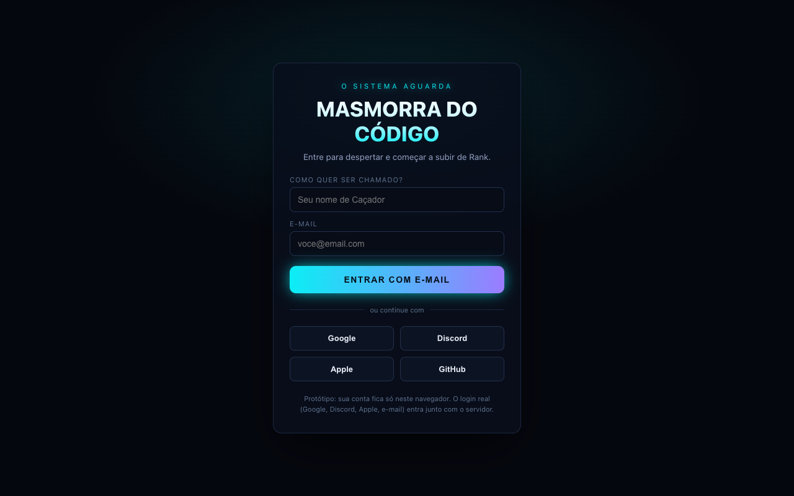
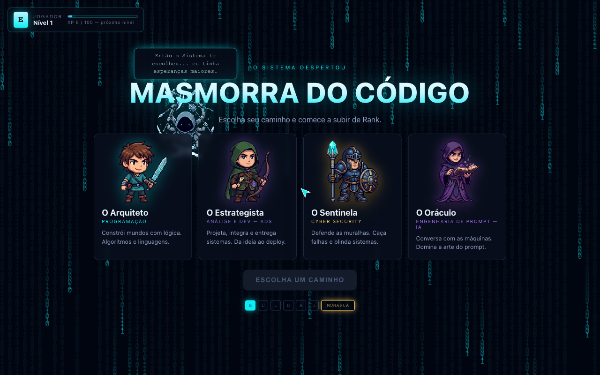
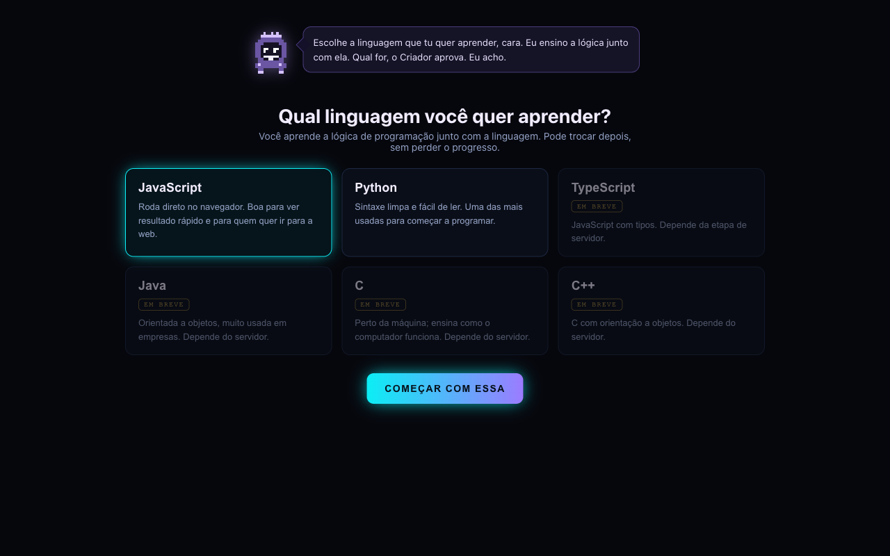

# Masmorra do Código

Plataforma gamificada para aprender programação, inspirada em RPGs de progressão por rank.
O jogador "desperta" no Rank E, escolhe um caminho e sobe de nível derrotando monstros, que são exercícios
de código resolvidos num editor dentro do navegador.

> Protótipo em desenvolvimento. O progresso fica salvo só no navegador; o login real entra junto com o servidor.

| Entrada | Escolha do caminho | Escolha da linguagem |
|:--:|:--:|:--:|
|  |  |  |

## Como funciona

- **Quatro caminhos:** Arquiteto (programação), Estrategista (análise de dados e desenvolvimento), Sentinela (segurança
  defensiva) e Oráculo (engenharia de prompt).
- **Você escolhe a linguagem:** JavaScript e Python rodam direto no navegador (Python via Pyodide). Java, C, C++ e
  TypeScript estão planejados e dependem de execução no servidor.
- **Ciclo de cada monstro:** aula (conceito, demonstração e prática guiada), exercício no editor, correção automática
  e recompensa de XP, com ranks de E até Monarca.
- **Lógica junto com a linguagem:** a aula vem antes do desafio na primeira vez, para o jogador não começar pedindo
  código sem entender o porquê.
- **Extras:** avatar, mochila com itens, mapa da masmorra, provas de rank e sequência de dias de estudo.

## Tecnologias

React 19, Vite, Monaco Editor (o editor do VS Code) e Motion para as animações. A execução do código do jogador
acontece em sandbox no próprio navegador.

## Como rodar

```sh
npm install
npm run dev      # http://localhost:5173
npm run build    # gera a versão de produção em dist/
```

## Estrutura

```
src/              telas e componentes do jogo (React)
src/dados/        monstros, aulas, itens, ranks e personagens
ferramentas/aulas gerador das aulas: transforma as lições em dados executando o código de verdade
public/           arte do jogo: heróis, monstros, cenários, emblemas e logo
```
